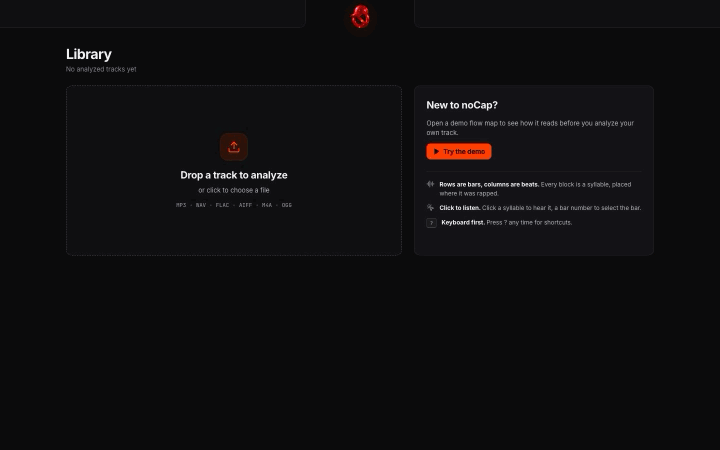

<p align="center">
  
</p>

<h1 align="center">noCap</h1>

<p align="center">
  A hip-hop flow & rhythm analyzer that maps every syllable to the beat grid —
  with real-time visualization, rhyme detection,  and deep timing metrics.
</p>

<p align="center">
  <a href="https://github.com/fatihserhatturan/noCap/releases/latest"></a>
  
  
</p>

<p align="center">
  <a href="https://fatihserhatturan.github.io/noCap/"><strong>Website</strong></a> ·
  <a href="https://github.com/fatihserhatturan/noCap/releases/latest"><strong>Download for macOS</strong></a> ·
  <a href="https://fatihserhatturan.github.io/noCap/#watch"><strong>Watch the 45-second promo</strong></a>
</p>

<p align="center">
  
</p>

---

## What is noCap?

noCap takes an audio file, isolates the vocals, transcribes every word with
word-level timestamps, and aligns each syllable to a beat grid. The result is
an interactive **flow map** — a piano-roll-style canvas where you can see and
hear exactly how a rapper rides the beat.

**It answers questions like:**
- How dense is the flow? (syllables per beat)
- How much syncopation is there?
- Is the delivery ahead, on, or behind the pocket?
- Where do the rhyme chains land on the grid?

Flow is the part of rap that is hardest to put into words. Producers, rappers and
fans describe it by ear: "laid back", "on top of the beat", "double time". noCap
makes it something you can point at, bar by bar.

---

## Install

1. Download the latest `.dmg` from [Releases](https://github.com/fatihserhatturan/noCap/releases/latest).
2. Open it and drag **noCap** into Applications.
3. Drop in an audio file, or press **Try the demo** to explore a sample verse first.

Needs a Mac with Apple Silicon (M1 or later). The app is signed and notarized by
Apple, everything it needs is bundled, and analysis runs offline on your Mac.

---

## Features

- **Beat detection** — BPM and beat grid from the raw waveform (librosa)
- **Vocal separation** — Demucs stem isolation for cleaner transcription
- **Speech recognition** — OpenAI Whisper with word-level timestamps
- **Syllable alignment** — CMU Pronouncing Dictionary for stress patterns
- **Flow metrics** — density, syncopation, pocket, timing variance per bar
- **Rhyme detection** — phonetic matching across perfect, slant, and internal rhymes
- **Interactive visualization** — WebGL canvas (Pixi.js), hover tooltips, click-to-play
- **Library** — save and re-open analyzed tracks
- **macOS desktop app** — self-contained Electron + PyInstaller bundle (no setup required)
## Keyboard shortcuts

Press `?` in the app to see this list at any time. Shortcuts are ignored while you are typing in a field or while a dialog is open.

| Group | Keys | Action |
|---|---|---|
| Playback | `Space` | Play / pause |
| Playback | `Enter` | Play selected bars |
| Playback | `L` | Loop selected bars |
| Playback | `V` | Switch mix / vocals |
| Navigation | `←` `→` | Previous / next bar |
| Navigation | `⇧` + click | Extend selection |
| Navigation | `↑` `↓` | Scroll |
| Navigation | `Esc` | Clear rhyme focus, then selection |
| View | `⌘` `+` | Zoom in |
| View | `⌘` `−` | Zoom out |
| View | `⌘` `0` | Reset zoom |
| View | `I` | Show / hide inspector |
| View | `1` `2` `3` | Flow / Report / Library |
| View | `?` | This list |

On Windows and Linux, use `Ctrl` in place of `⌘`.

---
---

## Getting Started

### Prerequisites

- Python 3.10+
- Node.js 20+

### Development

```bash
# 1. Clone
git clone https://github.com/fatihserhatturan/noCap.git
cd noCap

# 2. Python environment
python3 -m venv .venv
source .venv/bin/activate
pip install -e ".[dev,separator]"
pip install openai-whisper
pip install -e ".[apple]"   # Apple Silicon only: GPU transcription via MLX

# 3. Frontend dependencies
cd frontend && npm install && cd ..

# 4. Run (Flask API + Vite dev server + Electron window)
cd frontend && npm run desktop:dev
```

The first time you analyze a track, Whisper will download the `medium.en`
model (~1.5 GB) into `~/.cache/whisper/`. Subsequent runs use the cache.

On Apple Silicon, analysis runs on the GPU: Demucs uses MPS and, with the
`apple` extra installed, Whisper runs through MLX from the same checkpoint (same
DTW word timestamps, beam search). Anything that fails on the GPU falls back
to the CPU. `NOCAP_WHISPER_BACKEND=mlx|torch|cpp` and `NOCAP_DEMUCS_DEVICE=cpu`
pin a backend or device.

### Web-only mode (no Electron)

```bash
# Terminal 1 — backend
source .venv/bin/activate && nocap serve

# Terminal 2 — frontend
cd frontend && npm run dev
```

Open `http://localhost:8765`.

---

## Building the macOS App

Produces a self-contained `.dmg` that requires no Python or model installation
on the target machine.

```bash
./scripts/build-desktop.sh
# → frontend/dist-app/noCap-0.2.0-arm64.dmg  (Apple Silicon)
```

First build takes ~15 minutes (PyInstaller bundles torch + whisper + demucs).
Subsequent builds that skip the backend are much faster:

```bash
./scripts/build-desktop.sh --skip-backend
```

**Signing.** When the Keychain holds a *Developer ID Application* certificate and a
notarytool profile named `nocap-notary`
(`xcrun notarytool store-credentials "nocap-notary" --apple-id … --team-id …`),
the build signs, notarizes and staples the app, so Gatekeeper opens it without a
warning. Without them it falls back to an ad-hoc signature (users confirm the app
once in *Privacy & Security*); `--ad-hoc` forces that fallback.

---

## Where Your Data Lives

The library is one SQLite database plus a folder of audio files, in the standard
per-user app-data location:

| Run | Folder |
|-----|--------|
| Installed app | `~/Library/Application Support/noCap/` |
| Development (`nocap serve`, `npm run desktop:dev`) | `~/Library/Application Support/noCap-dev/` |

```
library.db            tracks, analyses (compressed flow maps), bars, sections
audio/<track_id>/     mix.<ext>, vocals.wav
```

Set `NOCAP_DATA_DIR` to use another folder. To back up the library, copy the whole
folder while the app is closed; to reset it, delete the folder.

Tracks saved by earlier versions (`~/.nocap_library/tracks`) are copied in
automatically on first start; the old folder is left untouched and can be deleted
afterwards.

---

## Tech Stack

| Layer | Technology |
|-------|-----------|
| Desktop shell | Electron 33 |
| Frontend | React 19, TypeScript, Pixi.js 8, Vite 6 |
| Backend | Python / Flask 3 |
| Library storage | SQLite (stdlib `sqlite3`, WAL) |
| Beat detection | librosa 0.11 |
| Transcription | openai-whisper (medium.en), MLX on Apple Silicon |
| Vocal separation | Demucs 4 (htdemucs) |
| Syllable/stress | CMU Pronouncing Dictionary |
| Packaging | PyInstaller + electron-builder |

---

## Project Structure

```
nocap/
├── frontend/src/        # React UI — components, hooks, Pixi rendering
├── nocap/audio/         # Beat detection, transcription, vocal separation
├── nocap/analysis/      # Flow metrics, alignment, rhyme detection
├── nocap/pipeline/      # Orchestration layer
├── nocap/web/           # Flask API + SSE streaming
├── nocap/text/          # Lyric parsing, syllable analysis
├── nocap/library/       # Track persistence
└── scripts/             # Build automation
```

All source files are kept under 200 lines — see `CODE_QUALITY.md`.

---

## Development Checks

```bash
python3 -m unittest -q
python3 scripts/check_line_limits.py
cd frontend && npm run typecheck && npm run build
```

---

## Contributing

Bug reports, ideas and pull requests are welcome.

- Found a problem or have an idea? Open an [issue](https://github.com/fatihserhatturan/noCap/issues), or start a thread in [Discussions](https://github.com/fatihserhatturan/noCap/discussions).
- Want to write code? Issues labelled [`good first issue`](https://github.com/fatihserhatturan/noCap/labels/good%20first%20issue) are a good place to start. See [Development](#development) to run it locally, and `CODE_QUALITY.md` for the house rules.

## Roadmap

- Builds for Intel Macs and Windows
- Better support for lyrics in languages other than English
- Comparing two verses or two rappers side by side
- More export formats for the flow map and the report

If noCap is useful to you, a star helps other people find it.
